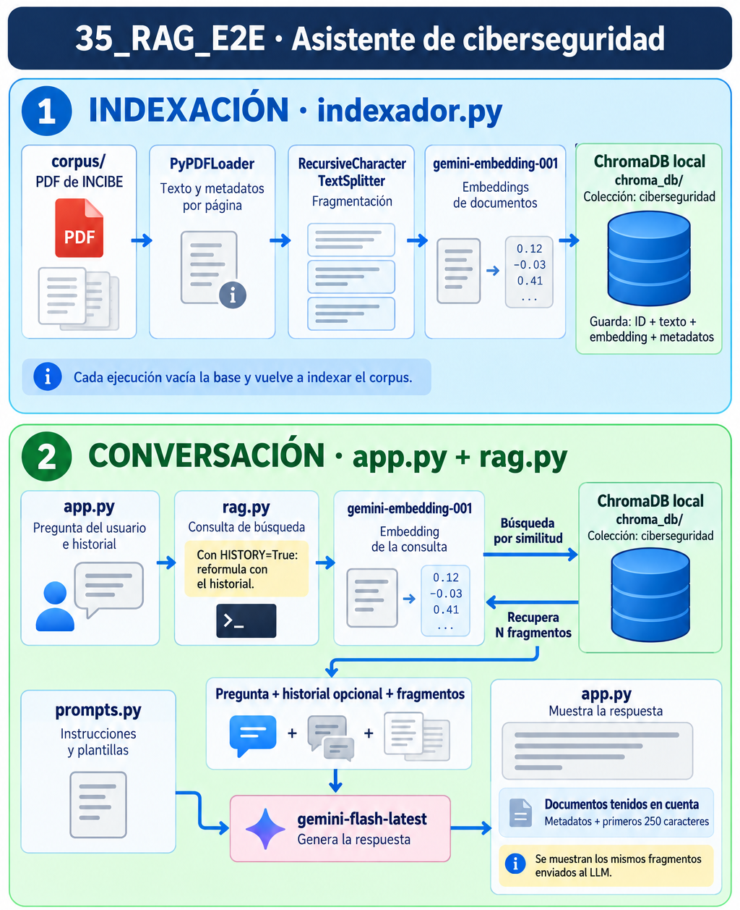

# 35. RAG E2E: asistente de ciberseguridad

Este proyecto implementa un sistema RAG de extremo a extremo (E2E) para consultar documentación de INCIBE sobre ciberseguridad cotidiana. Los documentos PDF se cargan, se dividen en fragmentos y se indexan en una base de datos vectorial ChromaDB guardada en local.

La aplicación permite conversar por consola con un LLM de Gemini. Para cada pregunta, recupera fragmentos del corpus y los incorpora al contexto del LLM para generar una respuesta. Después de responder, muestra los metadatos y los primeros 250 caracteres de los fragmentos recuperados y enviados al LLM, para facilitar la revisión de sus fuentes. El ejemplo tiene una finalidad docente para entender como funciona un RAG, no se espera que los resultados de las respuestas sean extrictamente correctas.

El siguiente esquema muestra el funcionamiento de la aplicación que vamos a desarrollar y el papel de sus principales ficheros. Se distinguen dos fases: la indexación, en la que los documentos PDF se fragmentan y se almacenan junto con sus embeddings en ChromaDB, y la conversación, en la que se recupera información para responder a las preguntas del usuario. Las dos representaciones de ChromaDB corresponden a la misma base de datos local.

<p align="center">
  
</p>


---

## Instalación del entorno virtual Python

### 1. Instalar uv

Si todavía no tienes uv, sigue las [instrucciones oficiales de instalación](https://docs.astral.sh/uv/getting-started/installation/) o el README del repositorio de la asignatura. Comprueba que está disponible en la terminal:

```bash
uv --version
```

### 2. Acceder a la carpeta del proyecto

Accede a la carpeta `35_RAG_E2E`:

```bash
cd 35_RAG_E2E
```

Los comandos siguientes deben ejecutarse desde esta carpeta. El entorno se creará dentro de `35_RAG_E2E`, separado del entorno general del repositorio.

### 3. Crear el entorno virtual

Creamos un entorno llamado `.venv_rag` con Python 3.11:

```bash
uv venv .venv_rag --python 3.11
```


### 4. Activar el entorno

La activación permite que el comando `python` utilice el intérprete del entorno creado.

**Windows (PowerShell):**

```powershell
.\.venv_rag\Scripts\Activate.ps1
```

**macOS / Linux:**

```bash
source .venv_rag/bin/activate
```

### 5. Instalar las dependencias

Con el entorno activado, instala los paquetes indicados en `requirements.txt`:

```bash
uv pip install -r requirements.txt
```

Comprueba que las dependencias instaladas son compatibles entre sí:

```bash
uv pip check
```


---

## API Key

Será necesario obtener una API Key poder hacer llamadas al LLM y usar los modelos de *embedding* para la indexación y consulta de documentos.

En este proyecto usaremos los **servicios de Google**, pero también podrian usarse los servicios de otros proveedores como OpenAI que ofrece LLMs y modelos de embeddings. Si se usa otro proveedor habrá que hacer pequeñas modificaciones en el código para usar los *Partner Packages* correspondientes: `langchain-openai`, `langchain-google-genai`, `langchain-anthropic`, `langchain-deepseek`, etc.


### 1. Obtener la clave

Accede a [Google AI Studio](https://aistudio.google.com/apikey) con tu cuenta de Google y crea una clave de API, o utiliza una que ya tengas disponible para Gemini. Puedes consultar el procedimiento en la [documentación oficial de Google](https://ai.google.dev/gemini-api/docs/api-key).

### 2. Configurar la variable de entorno

Los scripts leen la clave mediante la variable de entorno `GOOGLE_API_KEY`. En la misma terminal desde la que ejecutarás el indexador y el chat, define esta variable sustituyendo el texto de ejemplo por tu clave.

**Windows (PowerShell):**

```powershell
setx GOOGLE_API_KEY "TU_API_KEY"
```

**macOS / Linux:**

```bash
export GOOGLE_API_KEY="TU_API_KEY"
```

Esta configuración se aplica a la sesión actual de la terminal. Si abres otra terminal, tendrás que definir de nuevo la variable. Activar el entorno virtual no configura la clave de API.

### 3. Comprobar la configuración

Con el entorno virtual activado, comprueba que Python puede leer la variable sin mostrar su contenido:

```bash
python -c "import os; print('API key configurada' if os.getenv('GOOGLE_API_KEY') else 'Falta GOOGLE_API_KEY')"
```

Esta comprobación solo verifica que la variable tiene un valor; no realiza una petición ni valida la clave con Google. Las clases `GoogleGenerativeAIEmbeddings` y `ChatGoogleGenerativeAI` utilizan la variable al acceder a los modelos, sin necesidad de escribir la clave en `config.py`.

---

## Ejecución de la aplicación

La ejecución consta de dos pasos:

1. Preparar la base de datos documental con `indexador.py` 
2. Abrir el chat con `app.py`. 

Ejecuta los comandos desde `35_RAG_E2E`, con el entorno virtual activado y la variable `GOOGLE_API_KEY` configurada.

### 1. Indexar los documentos

El **indexador** es el script que prepara los documentos para que puedan recuperarse durante las consultas. Lee los PDF de la carpeta `corpus`, los divide en fragmentos, calcula sus embeddings y los guarda junto con sus textos y metadatos en ChromaDB.

```bash
python ./indexador.py
```

La base de datos queda guardada en la carpeta local `chroma_db`. Durante la ejecución se muestra el número de páginas y fragmentos, así como el progreso de la indexación. Al terminar, se imprime para cada fragmento su identificador, fuente, página, un extracto del texto y una muestra del embedding almacenado.

**Cada ejecución del indexador elimina todas las colecciones de la base local del proyecto y vuelve a indexar el corpus completo.** Los PDF originales se conservan. No es necesario repetir este paso antes de cada conversación, Espera a que termine antes de iniciar el chat.


### 2. Iniciar el chat

La **aplicación de chat** es la interfaz de consola que recibe las preguntas y muestra las respuestas del sistema RAG. Utiliza la base de datos ya creada, sin volver a indexar los documentos.

```bash
python ./app.py
```

Cuando aparezca `Tú:`, escribe una pregunta y pulsa Intro. La aplicación recuperará los fragmentos pertinentes y los enviará al LLM junto con las instrucciones del prompt y el historial de la conversación.

Después de cada respuesta se mostrará el bloque **DOCUMENTOS TENIDOS EN CUENTA**, separado mediante líneas horizontales. Incluye los metadatos y los primeros caracteres de los mismos fragmentos enviados al modelo. La longitud del extracto se controla mediante `PREVIEW_CHARS`, cuyo valor actual es 250.

Para finalizar la conversación, escribe:

```text
salir
```

### 3. Ejemplos de preguntas

Estas preguntas permiten explorar diferentes temas de los documentos del corpus y comprobar si los fragmentos recuperados respaldan las respuestas:

| Pregunta | Qué permite observar |
|---|---|
| ¿Qué es el phishing y cómo puedo reconocerlo? | Definición del ataque y señales para identificarlo. |
| ¿Qué diferencias hay entre phishing, smishing y vishing? | Comparación entre técnicas de engaño que utilizan distintos canales. |
| ¿Qué señales pueden indicar que una tienda online es fraudulenta? | Aplicación de las recomendaciones a las compras por Internet. |
| He recibido un SMS que dice ser de mi banco y contiene un enlace. ¿Qué precauciones debería tomar? | Respuesta ante una situación cotidiana concreta. |

Para comprobar el uso del historial, puedes continuar una pregunta sobre phishing con «¿Y cómo puedo evitarlo?» o «¿Puedes resumirlo en tres recomendaciones?».

La aplicación utiliza siempre el historial de la sesión para interpretar las preguntas de seguimiento y generar las respuestas. Al iniciar el chat, el historial está vacío; los mensajes se conservan en memoria hasta cerrar la aplicación.

También puedes formular una pregunta ajena al corpus, como «¿Cuál será el tiempo en Madrid mañana?», para comprobar si el asistente reconoce que no dispone de información suficiente. La recuperación puede devolver fragmentos aunque no respondan a la pregunta: conviene revisar su pertinencia y contrastar la respuesta con las fuentes.

---

## Ficheros del proyecto

El proyecto separa la indexación documental, la lógica del RAG y la interacción por consola. La siguiente tabla describe sus ficheros de código, documentación y corpus.

| Fichero | Descripción |
|---|---|
| `indexador.py` | Carga los PDF, los fragmenta, calcula sus embeddings y reconstruye la base de datos local. Al finalizar, muestra información de los fragmentos y vectores almacenados. |
| `app.py` | Punto de entrada del chat por consola. Recibe las preguntas, gestiona el historial y muestra las respuestas junto con los fragmentos enviados al LLM. |
| `config.py` | Configuración de rutas, colección de ChromaDB, modelos, temperatura, fragmentación, número de resultados y longitud de los extractos mostrados. |
| `prompts.py` | Plantillas de instrucciones para generar respuestas basadas en el contexto documental y reformular preguntas de seguimiento utilizando el historial. |
| `rag.py` | Inicializa la conexión con ChromaDB y los modelos. Recupera el contexto, genera la respuesta y devuelve los mismos fragmentos enviados al LLM para mostrarlos en el chat. |
| `requirements.txt` | Dependencias de Python necesarias para ejecutar el proyecto, ordenadas alfabéticamente. |


La carpeta `chroma_db` contiene los archivos de persistencia generados por ChromaDB al ejecutar el indexador. La carpeta `.venv_rag` contiene el entorno virtual y sus dependencias; no forma parte del código de la aplicación.

### Árbol de ficheros

El proyecto contiene los scripts, el fichero de dependencias, los PDF del corpus y la carpeta de la base de datos generada por el indexador:

```text
35_RAG_E2E/
├── corpus/
│   ├── guia_ciberseguridad_para_todos.pdf
│   └── osi-guia-ciberataques.pdf
├── chroma_db/
├── app.py
├── config.py
├── indexador.py
├── prompts.py
├── rag.py
└── requirements.txt
```
